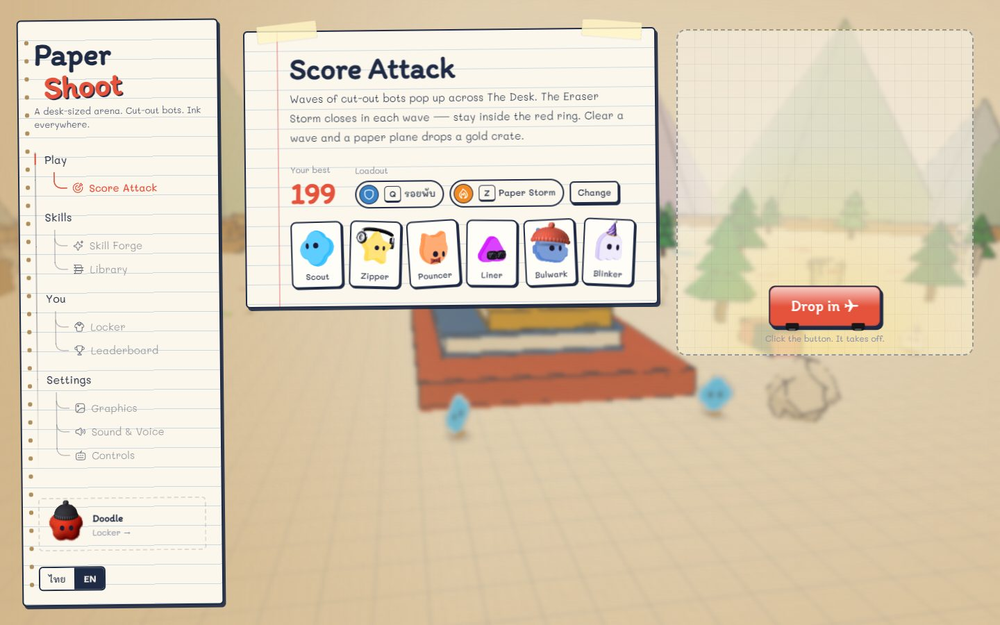
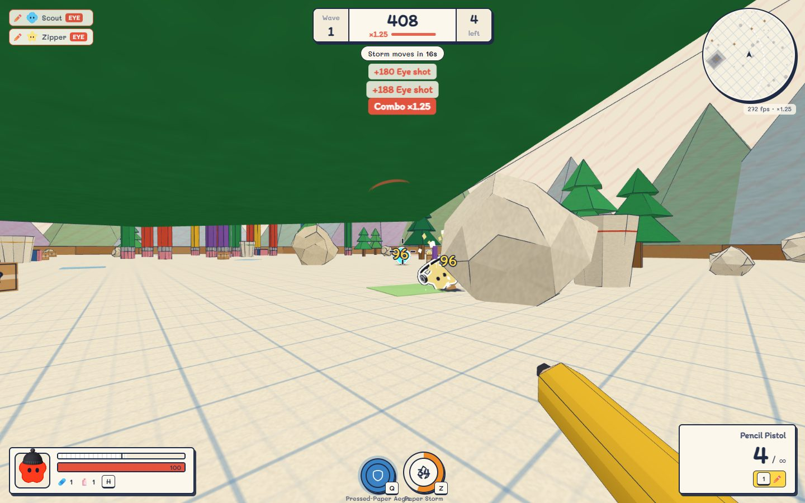
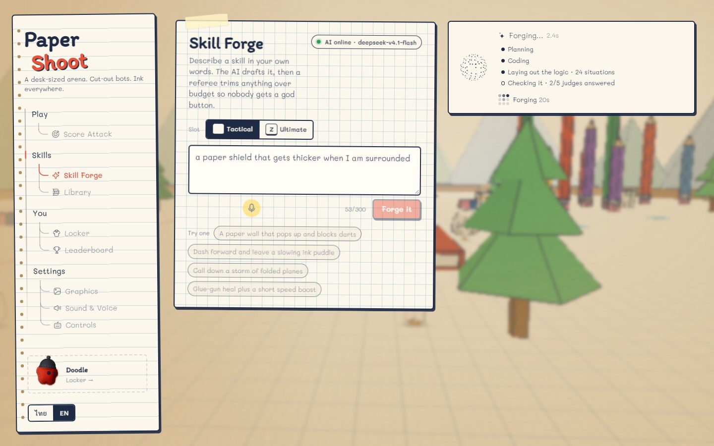
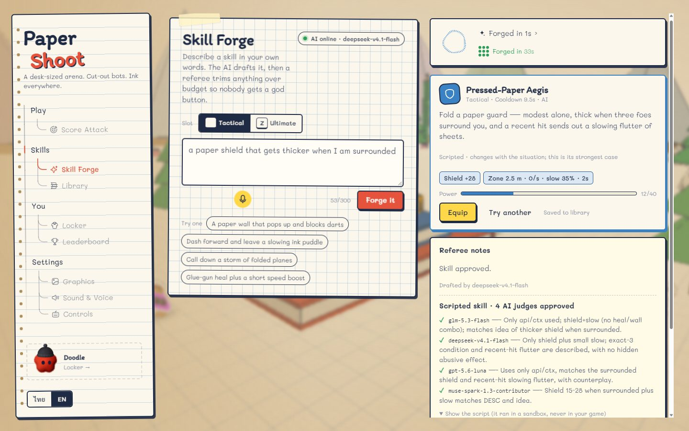
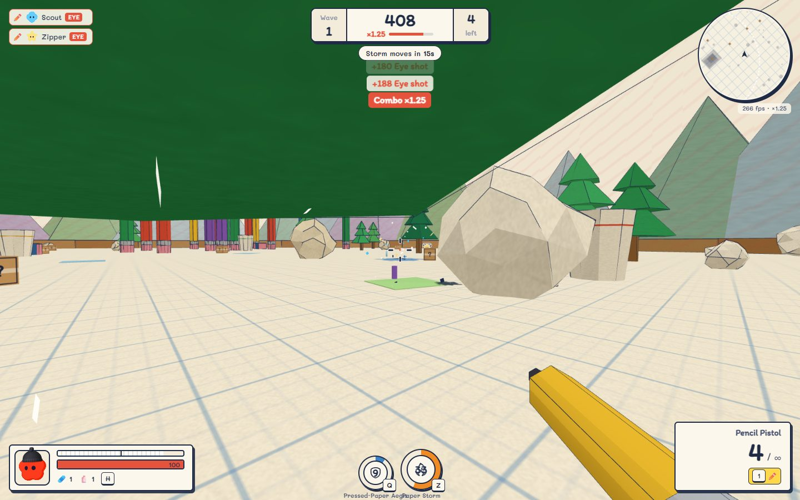

# Paper Shoot

A first-person arena shooter set on a desk. The bots are paper cut-out mascots on stands, the arena is a notebook page with stationery for cover, and the Eraser Storm closes the ring each wave. Score Attack: survive the waves, fold as many bots as you can, and climb the leaderboard.

You can also describe a skill in your own words — *"a paper shield that gets thicker when I'm surrounded"* — and a team of AI agents writes it, a sandbox measures it, and five AI judges vote on it before it reaches your hands.





## Run it

```sh
bun install
cp .env.example .env         # add OPENCODE_GO_API_KEY for the AI forge (optional)
bun dev                      # http://localhost:5173 — game + forge API in one process
```

Production:

```sh
bun run build
bun start                    # Bun serves dist/ and the API on http://localhost:4173 (PORT to change)
```

Keyboard and mouse, desktop Chrome or Edge (voice commands use the Web Speech API). TH / EN toggle in the menu.

## The skill forge: AI agents that build a skill

Type an idea (or say it), pick a slot — **tactical** (Q) or **ultimate** (Z) — and press *Forge it*. With a key configured, the forge runs a small team:

| Role | Who | What it guarantees |
|---|---|---|
| **Designer** | `deepseek-v4.1-flash` (falls back to `glm-5.3-flash`) | nothing — it proposes: a name, a description and a tiny script `onCast(api, ctx)` |
| **Referee** | our code (`src/server/codeReferee.ts`, `src/skills/balance.ts`) | runs the script in a **QuickJS sandbox on the server** once for each of the **24 situations** a skill can be cast in (low HP or not, shield up or not, 0 / 1 / 3 bots near, hit recently or not) and keeps only the **effect table** it produced. Every row must fit the slot's power budget on its own. |
| **Panel** | `glm-5.3-flash`, `deepseek-v4.1-flash`, `gpt-5.6-luna`, `mimo-v2.6-flash`, `muse-spark-1.3-contributor`, in parallel | each reads the script with its own lens (safety, red team, counterplay, hidden spikes, fidelity to your idea). At least 3 must answer, and **any single reject rejects the skill**. The panel can only veto; it can never approve something the referee refused. |
| **Game** | `src/game/Game.ts` | never runs AI code. When you cast, it looks up the row for the situation you're in and plays it, delayed effects on a timer. |

While it works you see what is actually happening, streamed from the server — **Planning** (the designer writing its plan), **Coding** (the moment its code starts arriving), **Laying out the logic · 24 situations** (the sandbox run), **Checking it · n/5 judges answered** (votes land one by one). The finished card shows each judge's verdict and the script itself.







**What keeps it fair.** The script can only call the ten building blocks the engine already has (`dash`, `heal`, `shield`, `projectile`, `area`, `buff`, `decoy`, `wall`, `reveal`, `pull`) plus `api.after(seconds, fn)`; it cannot see the clock, randomness, the network or the page. The sandbox has a 50 ms / 4 MB limit per situation, at most 12 effects and 4 delays. Power budgets are tactical 40 and ultimate 100; the cooldown is priced from the strongest situation. The same referee runs on the server, again in the browser, and again when saved skills are loaded, so an edited `localStorage` cannot smuggle in a god skill. Ask for something absurd ("nuke the map, immortal for a minute") and you get a scaled-down version that says so — or a rejection.

**When it can't.** No key, a busy provider, a timeout or a rejection → the classic forge drafts the skill from the ten building blocks instead (up to 3 effects, same referee), and the card says why. A whole forge stays within 60 s; a scripted one usually takes 20–35 s.

The rules each agent works under are written out in `src/server/codePrompts.ts` (designer D1–D13, panel P1–P7); the design and its trade-offs are in [ADR 0003](docs/adr/0003-code-skills-sandboxed-and-reviewed.md) (amending [ADR 0002](docs/adr/0002-ai-skills-as-refereed-dsl.md)).

### Configuration (`.env`, read by the server only — never a `VITE_*` variable)

| Variable | Default | |
|---|---|---|
| `OPENCODE_GO_API_KEY` | — | your OpenCode Go key; without it the offline forge is used |
| `OPENCODE_GO_BASE_URL` | `https://opencode.ai/inference/go/openai/v1` | OpenAI-compatible endpoint |
| `OPENCODE_GO_MODEL` | `glm-5.3-flash` | model for the classic forge |
| `PAPER_SHOOT_CODE_SKILLS` | on | `0` turns scripted skills off (classic forge only) |
| `PORT` | `4173` | production server port |

**Before you put it on the public internet:** there is no login. A scripted forge makes about 8 calls to your OpenCode Go plan, and the only limit is 12 forges per minute per IP (`allow()` in `src/server/forge.ts`). For a public deploy, put it behind a login, lower that limit, or set `PAPER_SHOOT_CODE_SKILLS=0`. OpenCode Go describes itself as made for coding agents — check its terms for a game.

## Controls

| | |
|---|---|
| WASD / Space / Shift | move / jump / sprint |
| C or Ctrl | crouch; while sprinting: slide |
| LMB / RMB | fire / aim down sights (every gun has its own sight) |
| R | reload |
| E | open crate · walking over a gun picks it up and equips it |
| Q / Z | tactical / ultimate skill |
| H | heal (tape → shield, glue → health) |
| G or MMB | ping |
| 1–4, wheel | weapons |
| V (hold) | voice command: reload · heal · skill · ultimate · switch · ping · pause (TH or EN) |
| Esc | pause |

## Performance notes

- React never renders inside the frame. The engine (`src/game/Game.ts`) owns the loop; the HUD store updates at 15 Hz; crosshair, hit marker, damage numbers and sights are DOM nodes touched directly.
- The whole static map is one merged mesh plus one ink-outline line mesh. Particles, decals, tracers, darts and skill balls are each one `InstancedMesh` with a fixed pool. No allocation in the loop.
- Every shader is compiled behind the loading card before the match starts, so the first shot does not stutter.
- No shadow maps, no post-processing, toon materials, fog-limited far plane. The menu's live backdrop renders at 40 % resolution, capped at 30 fps.
- Quality "Auto" lowers the render scale when fps drops below ~52 and raises it back above ~75. The fps and scale show in the HUD.

## Tests

```sh
bun test                     # 84 tests: referee, sandbox attacks, agent pipeline, streaming, voice parser…
bun run lint && bun run typecheck && bun run build
```

The sandbox suite (`tests/code-referee.test.ts`) feeds the referee 14 hostile scripts — infinite loops, memory bombs, `fetch`, `Math.random` and clock cheats, prototype tampering, a power spike hidden in one situation, a comment that tries to talk the judges round — and every one is refused.

## Where things are

`CLAUDE.md` is the working manual for the coding agent that develops this repo; `docs/adr/` holds the decisions, `docs/OPEN-WORK-LEDGER.md` the open work, `DONE.md` what shipped.

## What's original here

Genre mechanics (shrinking ring, shield + health, loot crates, slide) are shared with the battle-royale genre; names, weapons, bots, art and UI are this game's own: Pencil Pistol, Stapler SMG, Hole Punch, Ruler Rifle, the Eraser Storm, the mascots from `bot-avatars`.
